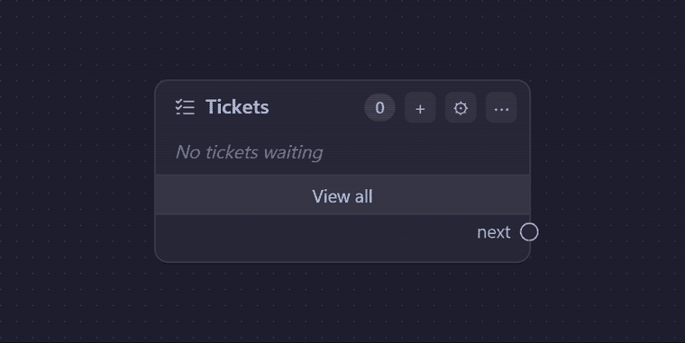
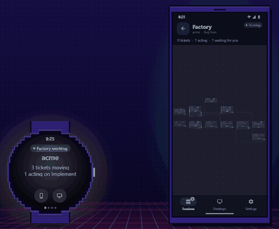
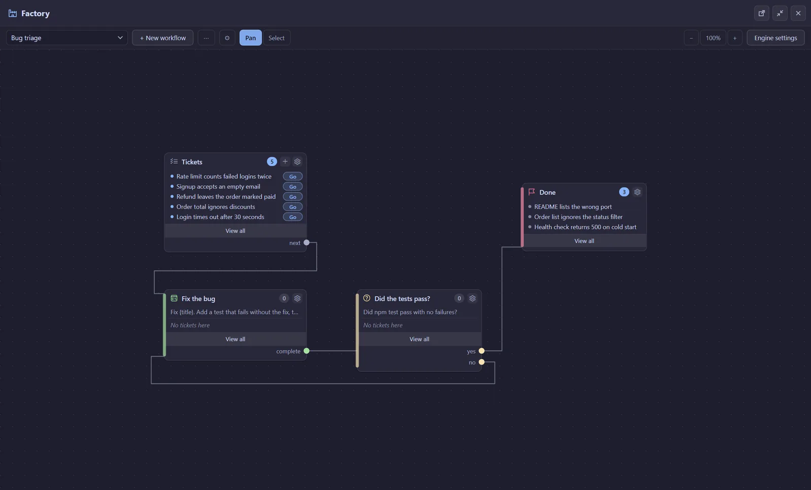
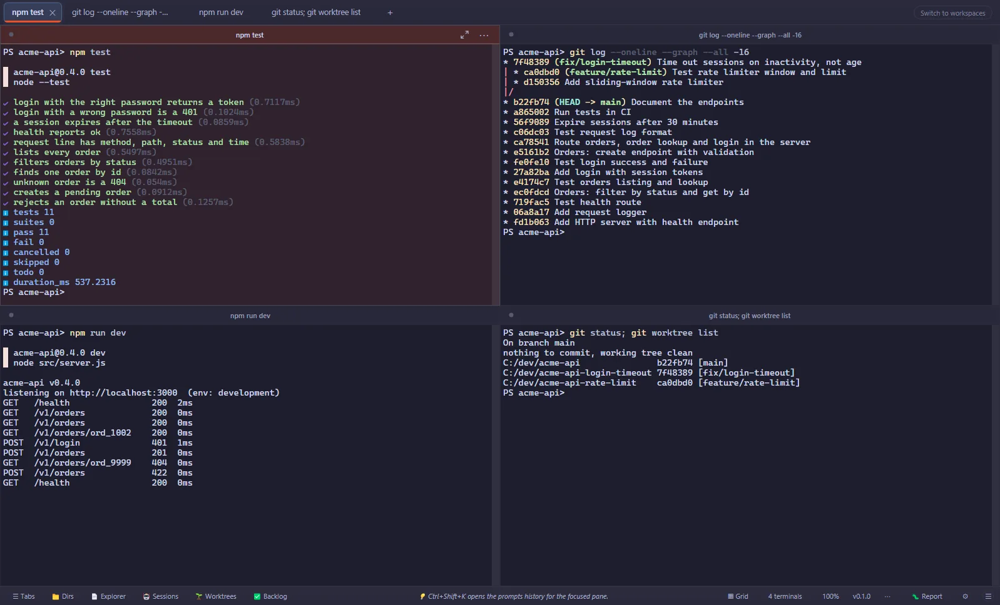
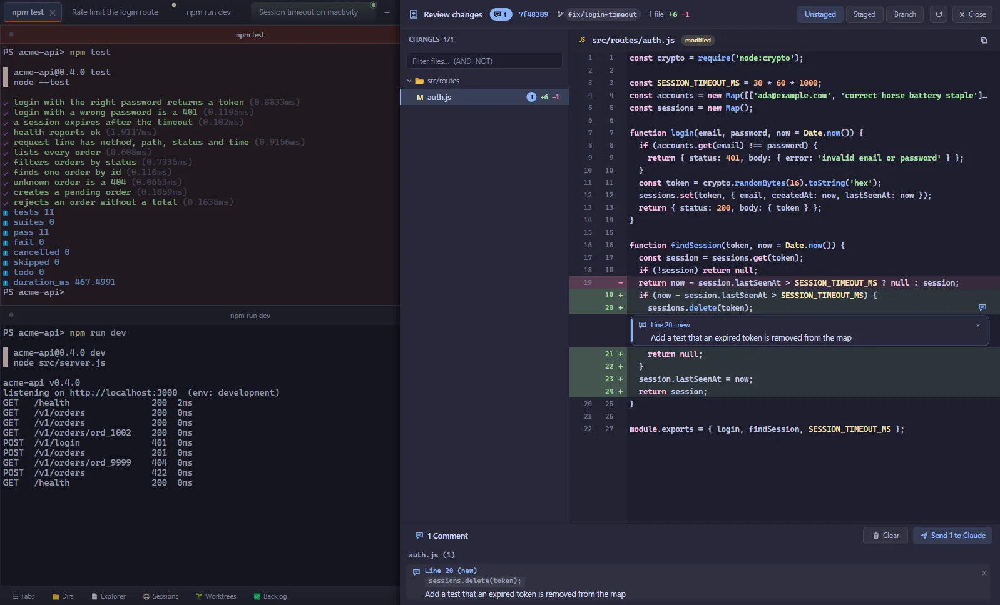
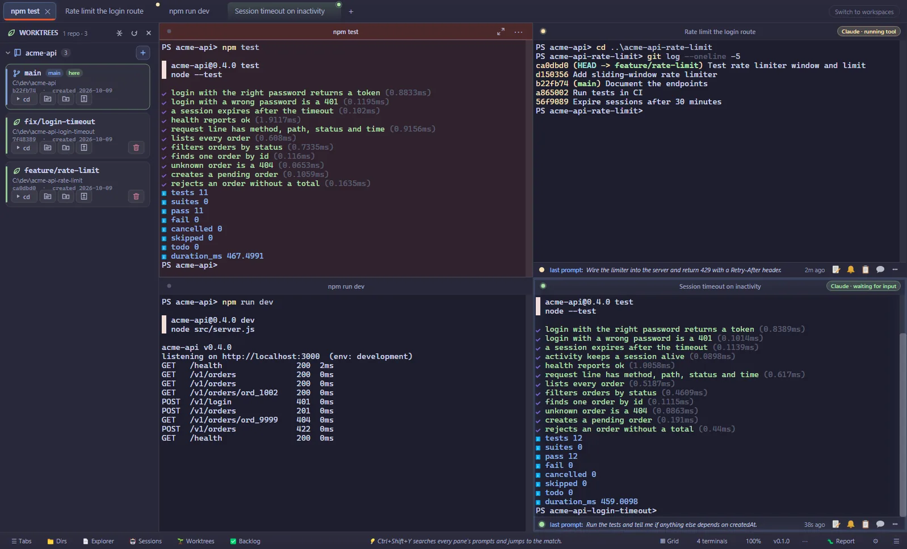

# TCC

**TCC is a Windows terminal for running many Claude Code and GitHub Copilot CLI agents at once: tickets flow down a workflow you draw, each in its own git worktree with its own agent, and your phone tells you when one needs you.**

## Install

Windows 10 or 11 (64-bit).

- **winget (coming soon):** `winget install ActiveSpark.TCC`
- **Installer:** [download the latest tcc-setup .exe](https://relay.tcc.activespark.io/download/windows-installer). It adds Start-menu and desktop shortcuts, and TCC keeps itself up to date.
- **Portable:** [download the latest .zip](https://relay.tcc.activespark.io/download/windows), unzip it anywhere and run `tcc.exe`.
- **Android phone:** [download the APK](https://relay.tcc.activespark.io/download/android), then pair it from TCC on your PC.

Every release is also on the [Releases page](https://github.com/ActiveSpark/tcc/releases), with its notes. The installer is not code-signed yet, so Windows SmartScreen may warn "unknown publisher": choose **More info**, then **Run anyway**.

## What it does

- **Factory:** draw a workflow (plan, review, implement, test) and drop tickets into it. Each ticket gets its own git worktree and its own agent session, and waits for you only where you said it should.
- **Many agents, one window:** split panes, tabs and a session list that shows which agent is working, which is done and which is waiting for you.
- **Review before you merge:** see each worktree's diff and send comments straight back to the agent.
- **Phone and watch:** follow sessions and Factory tickets, answer the agent that is waiting and press Next from your phone or Wear OS watch, on your network or through the end-to-end encrypted cloud relay.

| | |
|---|---|
|  |  |
|  |  |

## Links

- Website: [tcc.activespark.io](https://tcc.activespark.io/)
- Blog: [tcc.activespark.io/blog](https://tcc.activespark.io/blog/)
- Changelog: [CHANGELOG.md](CHANGELOG.md)

## Feedback

- Found a bug? [Open an issue](https://github.com/ActiveSpark/tcc/issues/new/choose). In TCC, **Report an Issue** (command palette) fills in your version and a diagnostics log tail for you.
- Ideas and questions: [Discussions](https://github.com/ActiveSpark/tcc/discussions).

## Licence

TCC is free to use. It is not open source: this repository holds the README, issue tracker and release downloads, and the source code is not published. See [LICENSE.md](LICENSE.md).
